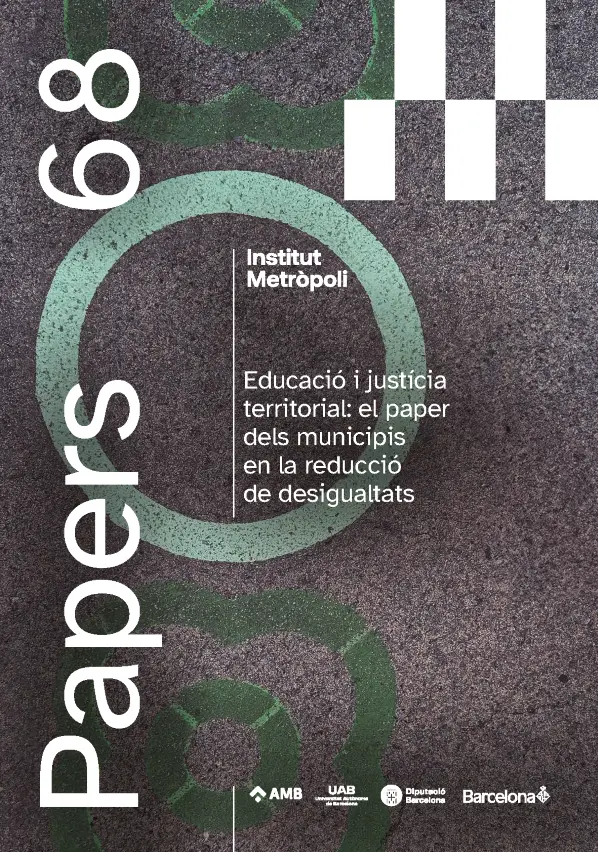
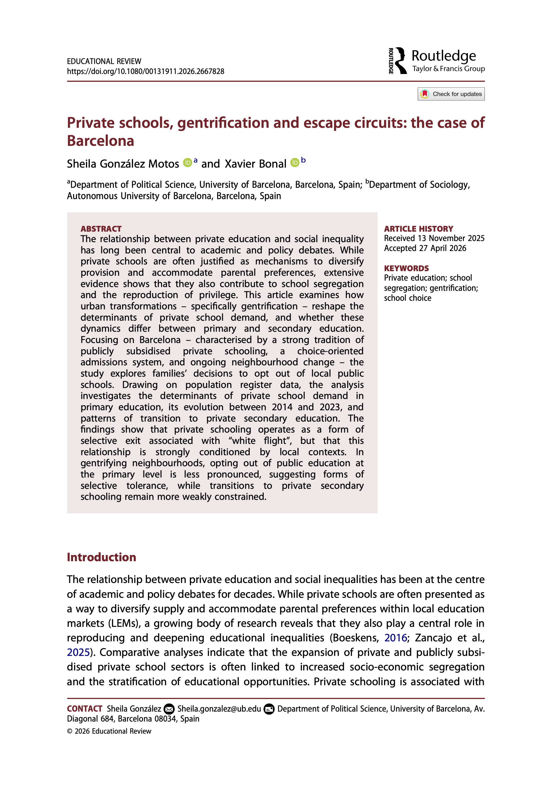

# Publicacions

:::::: outputs-grid
::::: output-card
::: output-cover-frame

:::

::: output-copy
### Una aproximació a la gentrificació escolar a Barcelona: mecanismes i implicacions per la política pública

**Marcel Pagès, Andreu Termes i Xavier Bonal**

A partir del cas de Barcelona, l’article analitza com processos com les migracions transnacionals i la turistificació influeixen en la gentrificació escolar. L’estudi identifica set mecanismes que expliquen aquest procés, vinculats a les estratègies escolars, els discursos pro-diversitat, l’homofília social i la reconfiguració identitària dels gentrificadors. Finalment, proposa recomanacions de política urbana i educativa per reduir els efectes negatius de la gentrificació escolar.

[Descarrega el document](../files/Revista_Papers_68_online_ART_5.pdf){.output-button target="_blank"}
:::
:::::

::::: output-card
::: output-cover-frame

:::

::: output-copy
### Private schools, gentrification and escape circuits: the case of Barcelona

**Sheila González Motos i Xavier Bonal**

L’article examina com la gentrificació transforma la demanda d’escola privada a Barcelona. A partir de dades del padró de població del període 2014-2023, analitza la renúncia de les famílies a les escoles públiques locals. Els resultats mostren que l’escolarització privada funciona com una sortida selectiva vinculada a la «fugida blanca», que varia segons el context local. Als barris en procés de gentrificació, la renúncia a l’escola pública és menys pronunciada a primària, fet que suggereix una tolerància selectiva, mentre que les transicions cap a l’escola privada a secundària continuen estant menys condicionades.

[Descarrega el document](../files/Private_schools_gentrification_and_escap.pdf){.output-button target="_blank"}
:::
:::::
::::::

