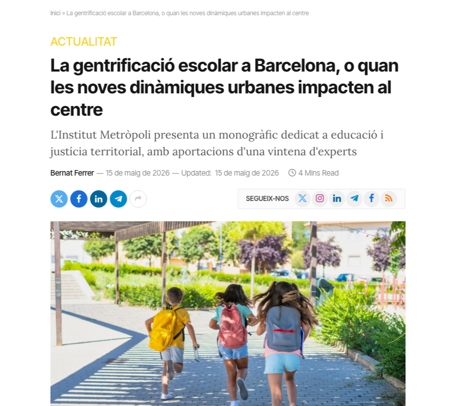
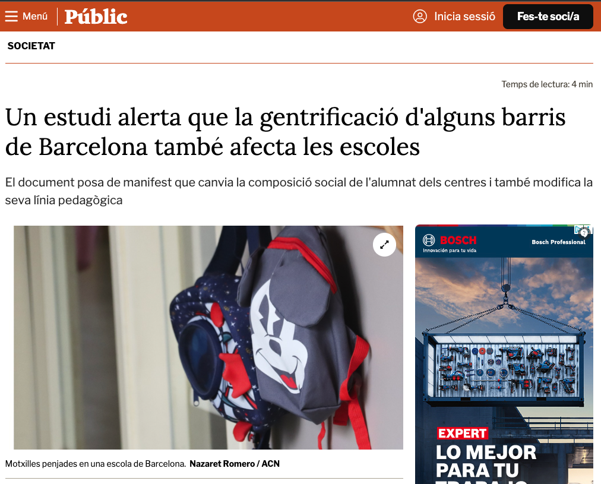
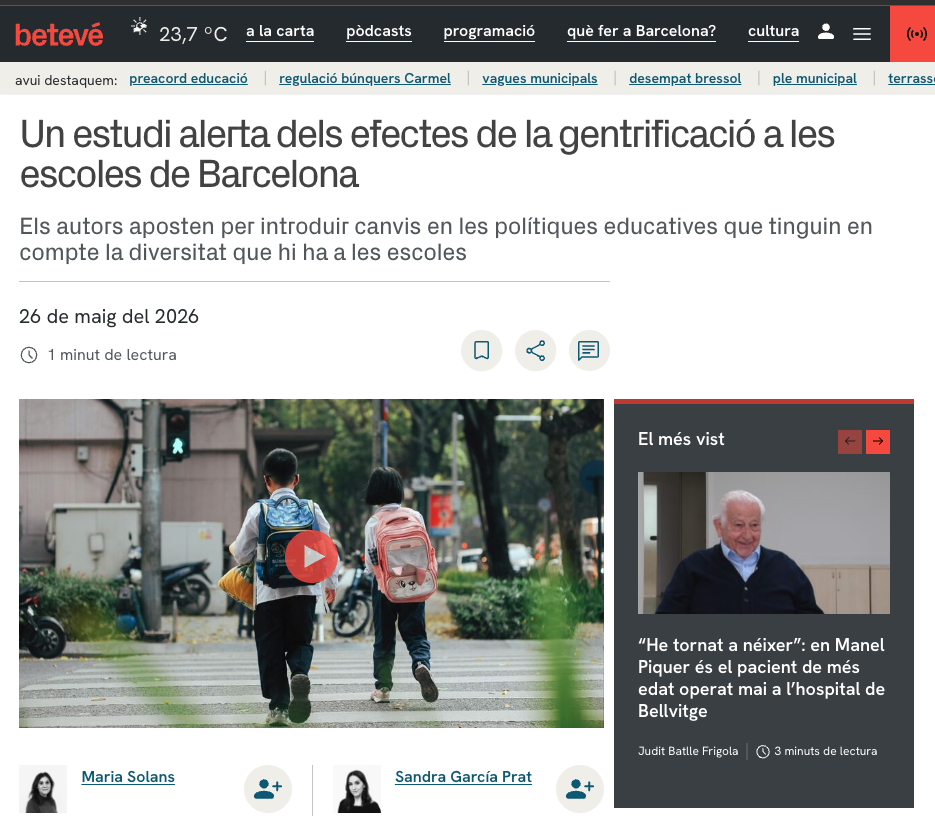
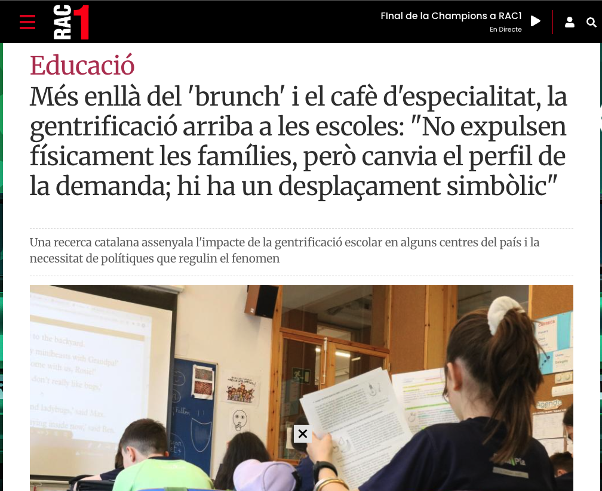
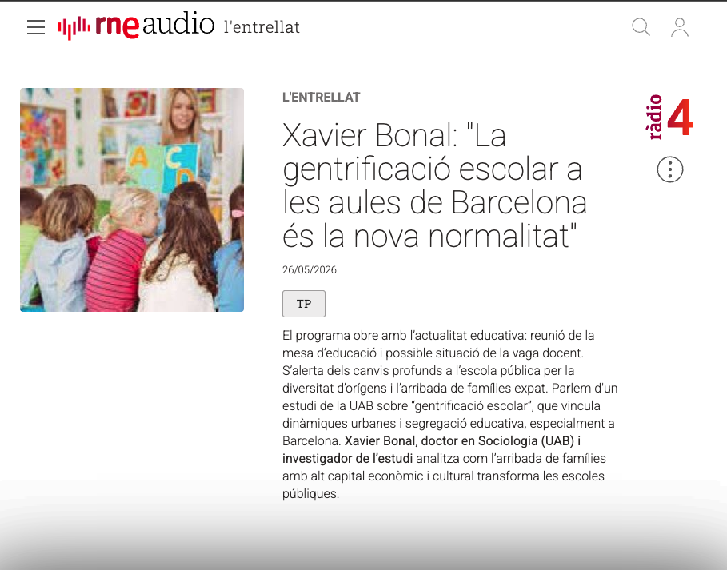

# Mitjans

::::::::::::::: outreach-grid
::::: outreach-card
::: outreach-image-frame

:::

::: outreach-copy
### [**La gentrificació escolar a Barcelona, o quan les noves dinàmiques urbanes impacten al centre**](https://educa.barcelona/2026/05/15/la-gentrificacio-escolar-a-barcelona-o-quan-les-noves-dinamiques-urbanes-impacten-al-centre/){target="_blank"}

Bernat Ferrer analitza com el canvi urbà, les migracions transnacionals i la turistificació configuren les dinàmiques escolars a Barcelona. L’article argumenta que les polítiques urbanes i educatives s’han de planificar de manera conjunta.
:::
:::::

::::: outreach-card
::: outreach-image-frame

:::

::: outreach-copy
### [**Un estudi alerta que la gentrificació d'alguns barris de Barcelona també afecta les escoles**](https://www.diaripublic.cat/societat/estudi-alerta-gentrificacio-alguns-barris-barcelona-tambe-afecta-escoles.html){target="_blank"}

Aquest reportatge explica com la gentrificació urbana transforma la composició social de l’alumnat, les dinàmiques escolars i l’orientació pedagògica dels centres. També destaca els riscos que aquest fenomen pot comportar per a l’equitat educativa.
:::
:::::

::::: outreach-card
::: outreach-image-frame

:::

::: outreach-copy
### [**Un estudi alerta dels efectes de la gentrificació a les escoles de Barcelona**](https://beteve.cat/societat/estudi-alerta-gentrificacio-escoles/){target="_blank"}

Aquesta peça presenta els efectes de la gentrificació sobre les comunitats escolars, el perfil de les famílies i la reputació dels centres. Emfatitza la necessitat de polítiques educatives adaptades a la diversitat de cada barri.
:::
:::::

::::: outreach-card
::: outreach-image-frame

:::

::: outreach-copy
### [**Més enllà del 'brunch' i el cafè d'especialitat, la gentrificació arriba a les escoles**](https://www.rac1.cat/societat/20260529/348793/brunch-cafe-especialitat-gentrificacio-aula-no-fisicament-desplacament-simbolic.html){target="_blank"}

L’article explora els impactes de la gentrificació als centres educatius, amb especial atenció al desplaçament simbòlic que es pot produir en barris en transformació. Subratlla la importància d’incorporar la dimensió educativa dins les polítiques urbanes.
:::
:::::
:::::::::::::::

# Entrevistes

:::::: outreach-grid
::::: outreach-card
::: outreach-image-frame

:::

::: outreach-copy
### [**L'Entrellat - Xavier Bonal: "La gentrificació escolar a les aules de Barcelona és la nova normalitat"**](https://www.rtve.es/play/audios/l-entrellat/lentrellat-xavier-bonal-gentrificacio-escolar-ales-aules-barcelona-nova-normalitat/17086865/){target="_blank"}

Xavier Bonal conversa a *L'Entrellat* de Ràdio 4 sobre la gentrificació escolar a Barcelona i els seus vincles amb les transformacions urbanes recents. L’entrevista aborda com l’arribada de famílies amb alt capital econòmic i cultural pot transformar les escoles públiques.
:::
:::::
::::::

